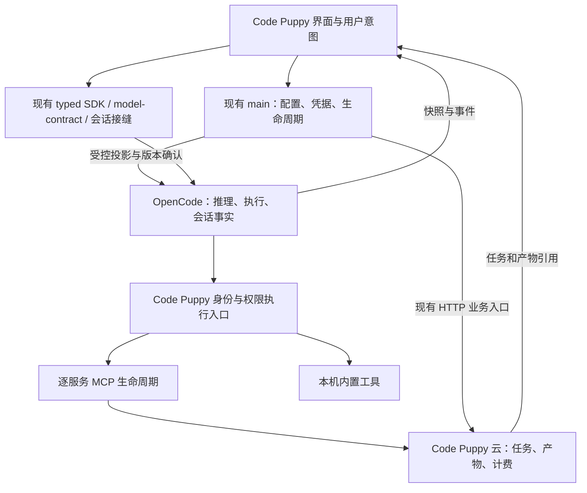

# Code Puppy 产品权威与运行稳定性

本方案服务于 [REQ-236](https://github.com/jinjunnn/alpha-work/issues/118)：用户续期登录、
切换模型或准备文件工具时，应继续查看会话、编辑草稿和使用其他已就绪能力；产品界面所表达的
模型、权限、来源和结果必须对应实际执行。这里提出架构方案，不表示代码已经实现或性能已经达标。

来源为 owner 2026-10-30 原话：「有哪些应该继续拿回主权，以及拿回主权的接缝是否合理」，
并明确把令牌续期重启、MCP 全体等待、接管文件仍参与上游合并纳入优化方向。
owner 也已明确「不需要考虑旧客户端兼容」。因此不建设旧客户端双协议或旧名别名；
当前文件、密钥、会话和授权的正确处理仍是本次变更的要求。

推荐按事实划分唯一权威：Code Puppy 控制产品决定及其强制执行边界；OpenCode 继续负责
推理循环和真实会话记录；Code Puppy 云服务控制云任务、路由与计费。一个产品可以拥有多个
职责明确的权威，不需要让 Electron main 成为所有业务状态的唯一数据库。

## 1. 只读勘破：现状与证据边界

源码基线为正式版 0.1.22 对应提交
[`393a35c2a9846984d041efc43fd27c604d73b666`](https://github.com/jinjunnn/alpha-code/tree/393a35c2a9846984d041efc43fd27c604d73b666)。
本机主检出停在 0.1.17，不能代替本基线。下列是源码事实；先前正式 App 的截图、辅助功能实测和
日志证据已挂在 REQ-236，本轮没有再次启动故障注入，也没有量出修复后的耗时。

| 接缝 | 基线事实 | 对本次设计的约束 |
|---|---|---|
| 界面 | `ui-mac/renderer/alpha-ui/session-workspace/alpha-session-workspace.tsx:1` 使用公开 `useServerSDK/useServerSync`，会话页已自持渲染。`frontend/README.md:1` 与实际恢复脚本定义 app/ui 为 pin + 产品补丁。 | 无需重做会话 UI 接管；本次修复在自有面完成，禁止退回依赖上游 DOM 选择器。 |
| 令牌续期 | `ui-mac/src/main/index.ts:728` 的 `onRenewed` 进入 token rotation；`:1444` 起 token-only 和 structural 都重新 fork，`:1458` 在之前 await 远端目录。token-only 不重载 renderer，但仍重启引擎。 | 需要拆开凭据更新、目录刷新和进程恢复。不能把“不刷新窗口”当作“不打断引擎”。 |
| 秘密装配 | `ui-mac/src/main/alpha-secret-files.ts:1` 描述 fork 时把凭据映射到文件；`opencode/src/config/variable.ts:33` 在配置加载时展开 `{file:}`；`opencode/src/provider/provider.ts:1467,1846` 缓存 SDK。 | 只改秘密文件或停止 respawn 不足以证明新凭据生效，必须修改实际请求/transport 的取凭据接缝。 |
| 目录刷新 | `ui-mac/src/main/alpha-platform-models.ts:121` 已有序号和账户身份仲裁、一次后台超时补试；`:64` 单次请求预算 8 秒。`models-ipc.ts:9` 特意避免在每次读取时启动刷新。 | 保留现有仲裁；补共享在途请求与生命周期调度。不能再在每个组件读目录时各发一次刷新。 |
| 模型目录 | `alpha-live-allowlist.ts` 是平台目录投影，picker 与 sidecar 共享该投影；sidecar 在 fork 时消费，界面另经 IPC 读缓存。`model-contract.ts:174` 等 marker 后再请求引擎目录。 | 同一个投影函数不等于同一个已应用版本；需要区分下载版本与引擎应用确认。 |
| 会话模型 | `alpha-composer.tsx:1079` 经 v2 switchModel 更新；`:1712` 发送走 v1 promptAsync。`opencode/src/session/prompt.ts:656` 从共享 SessionTable 读取当前模型，`:688` 仍允许输入/agent 模型先于该值。 | v1/v2 路径混用在这里有真实共享数据链，不能仅凭名称判错；应验证最终请求与显式用户选择一致，并明确 agent 推荐模型的优先级。 |
| MCP 初始化 | `opencode/src/mcp/index.ts:557` 的 InstanceState 初始化并发连接所有启用服务，但 `Effect.forEach` 完成后才返回状态。创建服务包含 connect 与 tools/list；`session/tools.ts:480`、`session/system.ts:121` 都等待该状态。 | 并发启动仍有全体等待；改成独立生命周期、增量发布。 |
| 核心启动 | `opencode/src/project/bootstrap.ts:33` 明确等待 config 与 plugin.init，没有直接等待 MCP 全体连接。 | Office 的 `spawn uv ENOENT` 可证明工具失败，不能单凭同时间日志声称它是所有“同步中”的根因。 |
| 权限与来源 | ADR-033/038/041 已接管权限及工具身份的具名文件；`schema/src/tool-identity.ts` 定义身份，`permission/alpha-tool-policy-gate.ts` 合成策略，`session/tools.ts:83` 执行前重读绑定。 | 已有产品权威，继续修正其接线；不能再造第二个审批器或按名称认官方工具。 |
| 插件顺序 | `ext/src/plugin-fanout.ts:9` 自有 hook 先于项目 hook，后者仍能改变共享输出；`session/tools.ts` 的 identity gate 包住执行，内部随后调用 before hook。 | 自有 hook 先运行不代表最终裁决不可覆盖。需要检查配置提交和副作用前的最终事实，而不是增加更多前置字符串补丁。此项是边界分析，尚未构成漏洞复现实证。 |
| 云任务与产物 | `ui-mac/src/main/alpha-cloud-jobs.ts:1` 的 main HTTP 与 agent MCP 访问同一云任务业务入口；已有 artifact service、descriptor、manifest、workbench。 | 本机接管交付体验，云端保留任务/计费事实；MCP 改为 HTTP 本身不能消除业务问题。 |
| 上游同步 | `scripts/north-star-guard.sh:161` 等允许修改已接管路径；`sync-upstream.yml:159` 仍将 app/ui 和 lockfile 之外的合并冲突判为失败。现行 `upstream-integration.md` 记录了接管文件引起的持续冲突。 | 修改白名单不是同步隔离机制；“L3 冻结”的目标与实际合并行为需要明确对齐。 |

表中 `ui-mac`、`opencode`、`ext`、`schema` 均为 `packages/` 下的包。
这些锚点可在固定提交中复读，不能把历史 ADR 的旧缺陷直接当作当前缺陷：例如旧文档说
permission.ask 可用，而后续勘破指出缺少触发点；设计应核对生产调用，不以 hook 类型存在为证。
详见 [事件面勘破](../architecture/engine-command-and-event-surface.md) 和
[当前上游集成规则](../architecture/upstream-integration.md)。

## 2. 推荐方案、权威归属与接缝选择

### 2.1 继续接管什么

| 事实/决定 | 唯一权威与既有落点 | 接缝及本期变化 |
|---|---|---|
| 用户产品配置、供应商地址、凭据归属 | main 的配置写入口、`custom-provider-truth.ts`、Keychain | 经现有 IPC 接收命令，校验后写；引擎只接收执行投影，不能反向改地址真源。保留用户可编辑字段，保护字段由现有配置所有者枚举。 |
| 平台模型、路由、价格 | alpha-platform registry/edition；本地 `alpha-live-allowlist.ts` 校验投影 | 本地保存已验证快照并后台刷新；引擎报告应用版本，不另造允许列表或从 models.dev 覆盖价格。 |
| BYOK 公共模型元数据 | REQ-237 的独立远程目录；自定义节点仍由本机用户决定 | 与平台复用拉取/缓存机制，权限和数据真源分开；不因云账户失败停用 BYOK，不用远程目录改写用户 key/baseURL。 |
| 模型和工作模式选择 | Code Puppy composer 的显式用户意图；引擎会话字段保存已应用事实 | 选中、正在应用、可执行分开。使用现有 model-contract 与发送入口，补最终执行模型回执；agent 模型只作未显式选择时的默认。 |
| 工具身份、官方来源、策略 | 共享 identity schema、已验证 binding graph、现有 policy gate | 在注册端产生，执行端核对；UI 只展示。`not-asserted` 是来源证明不足，不等于工具坏了，也不能仅因品牌相似改成官方。 |
| 工具可用性 | 现有 MCP runtime 的每个服务状态；main 管运行依赖准备 | 发布逐服务状态，不以“出现在目录里”代表连接成功。第一次调用只等待目标服务。 |
| 生命周期与恢复 | main 的 sidecar-generation、token-rotation、现有恢复入口 | main 决定是否重启，renderer 发重试意图；原因细分并合并在途工作，取消无关功能引发的全局重启。 |
| 消息、工具执行记录、推理循环 | OpenCode 当前 v1 会话/持久化服务 | 产品拥有输入和展示合同；不在 main 复制一份可写消息历史，不以 UI 乐观状态宣布执行完成。 |
| 草稿、附件与结果呈现 | Code Puppy 自有 composer/timeline/artifact 服务 | 附件立即可见，解析有独立状态；产物以稳定引用绑定会话。云任务完成不等于本机文件保存成功。 |
| 云任务、用量和金额 | alpha-platform 现有 job/artifact/ledger 入口 | MCP 与 HTTP 都作为适配器，使用同一身份、输入合同、幂等和计费路径。UI 可直接驱动既有 HTTP 入口；不建设第二套 dispatch。 |
| 接管代码的发布版本 | 仓内上游同步规则与固定候选提交 | 让同步行为真正服从所有权，不能只靠守卫放行或升级后临时修冲突。 |

此图是职责图，不是要求新建这些服务或通用 facade。复用既有模块，只对下述真实缺口增加窄接缝。

### 2.2 普通令牌续期不再重启引擎

目标是同一账户、同一权限、同一服务地址的 token rotation 不改变 sidecar generation，不重载
renderer，不清空会话授权，不中断正在输出的回答，也不等待模型目录刷新。

推荐链路：main 验证续期结果 → 安全地更新现有秘密通道 → 发布单调凭据版本 →
实际请求适配器确认应用 → 后续请求使用新令牌。传递的是受限凭据引用/版本，原始 token
不进入 renderer、普通配置、日志或子进程环境。秘密文件若继续使用，更新需原子替换，
读写双方限制在 main 指定的真实路径，不能接受模型或项目插件指定路径。

两个消费者必须一起改：

1. **模型请求**：在实际发往平台的请求边界读取当前凭据，或按凭据版本仅重建该 provider
   的 SDK；不 dispose 整个项目实例。SDK 缓存不得继续保留旧 key。必须以真实请求验证 header
   合成顺序，不能仅在 `chat.headers` 前置 hook 写一个值就假定它胜过 SDK 默认和后续插件。
2. **云 MCP**：更新该服务的认证上下文；若当前 transport 只能在构造时接受 header，只重连
   这个服务，其他 MCP、会话和引擎保持运行。在途云任务用 job ID 查询结果，不自动重新派发。

`provider/provider.ts` 当前不在上述 ADR-041 接管表中。实现优先检查现有 SDK/provider 接缝是否
能在真实发送边界满足合同；若必须改该文件，以具名窄补丁及对应 ADR 交付，不能顺手扩大上游
排除目录。这不是“旧客户端兼容”，而是当前运行时缓存与调用顺序的正确性要求。

| 变化 | 恢复范围 | 对在途操作的处理 |
|---|---|---|
| 同身份普通续期 | 凭据版本与受影响 provider/MCP | 保持流；下次请求换凭据；不自动重放已受理调用。 |
| 登出、撤权、切换账户 | 撤销对应凭据及绑定，取消对应云能力，重新确认新身份 | 不能把旧账户请求/产物投给新账户；本机 BYOK 和草稿不被无条件清空。 |
| 修改 provider 地址、协议或模型结构 | 重建该 provider 的执行投影和出网授权 | 当前使用该 provider 的运行先安全结束或明确中止；不靠全局 renderer reload 生效。 |
| MCP 定义改变 | 对应 server generation | 取消旧连接，旧回调不得复活它；必要时重新授权绑定。 |
| 引擎进程退出、健康不可恢复、必须重新施加进程围栏 | 既有 sidecar recovery | 发布有终态的恢复状态；保留草稿，恢复后重取事实；无已确认受理证据不得重复发送。 |

云目录刷新独立运行，不再位于 respawn 的 await 前置链；启动与恢复消费合适账户/环境的已验证缓存。
缓存只用于目录可见性，不能把缓存中的价格/权限当成新的扣费授权。凭据更新失败只使受影响云能力
进入“需要重新登录/重试”，不能无限重启来掩盖失败。

### 2.3 MCP 独立启动，避免全体等待

第一步是在已接管的 `opencode/src/mcp/index.ts` 初始化状态时立即返回每个服务的初态，并把
连接工作放入绑定实例生命周期的后台任务；限制同时启动的进程数，完成一个发布一个。
finalizer 必须在派发后台任务前注册，实例销毁会取消连接与子进程，迟到成功不能写回旧实例。
不能仅把现有 `Effect.forEach` 改成未托管的 fire-and-forget。

每个服务用 `configured → preparing → connecting → ready | failed` 表达实际阶段；
disabled 是用户配置事实，不能和失败混在一起。依赖缺失直接给出具名失败及修复动作，
不无限重试 `ENOENT`。分别设定运行环境准备、握手、tools/list、工具调用的预算，
禁止把一个短连接超时同时用于长耗时 PDF 或生图调用。

**可发现与可执行必须分开**：

- 第一方 Office 工具的完整描述应从实际 `resources/office-mcp/server.py` schema 同源导出，
  校验 bundle/依赖版本后允许在尚未连接时参与能力选择；执行时只唤起并等待该服务。
  现有目录只有名称/简介，不能据此编造 inputSchema 或假装已握手。
- 第三方首次连接尚无可信 schema 时，不向模型广告虚构工具；设置页可显示“正在连接”。
  有缓存也要绑定相同服务定义和版本，调用前完成 initialize 并校验目录；变化后使旧绑定失效。
- `session/tools.ts` 现有工具对象持有 client，需改为绑定身份与该服务执行入口，避免在工具
  广告阶段强制拿到所有 client。同一轮模型请求固定已选工具定义；后台目录变化供下一轮使用，
  不在正在执行的一轮里静默替换 schema。
- `session/system.ts` 只读就绪服务的 instructions；若用户明确选择某项能力，准备该能力后再
  组装对应一轮，不把“工具尚未准备”误报成模型不具备能力。

MCP 的 initialize/initialized 顺序仍须遵守；异步化只改变客户端调度，不跳过协议握手。
参考 [MCP 生命周期](https://modelcontextprotocol.io/specification/2025-11-25/basic/lifecycle) 与
[工具发现及变更通知](https://modelcontextprotocol.io/specification/2025-11-25/server/tools)。

本机运行依赖由产品准备阶段管理；探测与 spawn 使用同一个已解析绝对路径和环境。
首版选择固定、可复现的随包运行环境或独立准备产物，不能依赖 GUI 能找到用户 shell 中的 uv，
也不能在第一次普通对话中才临时下载四套依赖。本期不为此新建 Local Daemon。

### 2.4 产品决定经接缝落到最终执行

**配置**：沿 `alpha-config-injection.ts`、`ext/project-config.ts` 和现有真源文件生成执行投影。
对模型、第一方服务地址、权限及来源证明等受控字段，检查应在最终配置提交/执行边界，不能只在
自有插件最先执行时检查。先导出真实写入方和允许扩展字段清单，再验证项目插件能否覆盖；
不把所有用户配置封死，也不复制另一套 Config 合并器。当前自有 hook 先执行的事实意味着这项
必须测试，但本方案不宣称已经复现所有字段可被覆盖。

**权限**：现有 identity gate 继续作为唯一策略合成入口，UI 的“全部批准”是用户策略输入，
不能覆盖禁用、撤权或出网围栏。审批绑定真实主体、资源、参数和请求 ID；若 hook 改变了审批
依赖的事实，必须重新判定或拒绝，不能把批准原参数当作批准新参数。实现复用现有 permission
receipt/binding 语义，不增加第二个 approval service。

**模型**：Code Puppy 持有显式选择，agent 提供缺省建议；展示目录、执行投影及已应用模型要能
核对同一版本。保留当前 v1 会话执行代次；v2 model 元数据接口不意味着会话执行已迁移。
不因“更多主权”在本 fix 中重写 agent loop 或切换到另一代引擎。

**状态与界面**：沿现有 model-contract、runtime-recovery 和 SDK/IPC 增量表达“界面可用、
引擎在线、目录已缓存/已应用、目标模型可执行、目标工具可执行”；不要把这些压成一个全局
`loading`。快照用于恢复，事件用于更新；失联或错过事件后重新读快照。复用既有 generation、
request ID、session ID，只有实际缺少时才补版本字段，不建设通用 Event Store。

**图片与文件**：附件的选择、准备、发送受理、模型已读取是不同事实；工具准备失败仍应保留
附件卡。图片生成用云 job 事实驱动生成中状态，完成后把 artifact descriptor 投影到 timeline，
点击预览与保存复用已有 artifact service；下载 URL 是短期传输凭据，不是产物身份。
这是产品交付权威，应由 Code Puppy 自持，不能靠模型最后一段自然语言宣告成功。

### 2.5 让接管与上游同步真的一致

前端继续使用已经存在的 **pin + 单一补丁 + round-trip**，本期不整包 fork app/ui。
后端建议把现有 `UPSTREAM_EXCLUDES` 的接管范围改成同步流程也消费的具名所有权清单：
复用现有守卫作为清单来源或迁出为一份由守卫与同步脚本共用的数据，不能另抄第二份名单。

每个路径明确选一种处理方式：上游镜像、具名补丁、Code Puppy 接管。仅本次触及及已声明
接管的范围参与，不借此把整个 provider/core/server 目录排除。

推荐同步过程：固定当前发布与上游候选 SHA → 检查候选是否触及接管路径 →
未触及的普通合并照常验证；触及的进入具名升级审查，列出两侧差异与依赖影响。
接管内容在候选构建中不得被静默覆盖；吸收上游修复是显式移植并经过行为检查。
**不能采用全局 `merge=ours` 或自动选一侧**：那会把安全修复和接口变化一起隐藏。

“接管文件不自动被覆盖”可机械验证；“以后没有升级维护成本”不可承诺。已接管范围的上游
安全修复仍须评估，报告要保留上游候选和处置依据，不能只积压冲突告警。
发布版使用已验证的固定组合，上游候选的失败不影响正在使用的版本。

该变化需要同步规则/ADR 的具名更新，属于独立发布链变更；本设计不改受保护的 ADR，
也不把当前“L3”文字自动解释成已经拥有正确的隔离机制。详见
[ADR-029](../../.claude/rules/adrs/ADR-029-upstream-sovereignty-ladder.md)、
[ADR-041](../../.claude/rules/adrs/ADR-041-tool-identity-ledger.md) 与
[上游集成现状](../architecture/upstream-integration.md)。

### 2.6 未采用的替代与未来方向

| 替代 | 本期不采用的原因 |
|---|---|
| 继续每次刷新 token 就重启，只把 loading 文案改短 | 没有消除进程、MCP、会话恢复的耦合；只能减轻视觉症状。 |
| 去掉目录 marker，直接展示引擎中间目录 | 可能暴露尚未治理的目录；应独立展示可信缓存并等待执行投影确认。 |
| 只缩短 MCP 全局 timeout | 仍然等最慢服务，并可能误杀长工具调用。 |
| 仅以 plugin hook 声明主权 | hook 可缺触发点，也可能在后续被覆盖；不等于实际执行边界。 |
| 所有模型/本机工具改走云端 | 损害 BYOK、本机文件边界与离线能力；协议换成 HTTP 也不会自然改善业务合同。 |
| 复制全量 SDK 包装层、重建消息库或完整 Tool Broker | 当前已有接缝、schema、权限和持久化所有者；重复实现增加双真源。 |
| 立即彻底 fork 引擎、重写 agent loop | 本期没有证明成本收益；增加维护与行为回归面。必要的窄接缝单独接管足够。 |
| 全局字符串替换 Alpha 或自动选 ours | 分别会破坏第三方/用户内容和上游修复；都不能替代真实所有权清单。 |

与 owner 提供的 `alpha-work/docs/harness-platform-v1` 对齐：本地生命周期归本机宿主，
授权归身份/策略与执行 gate，云 job 与 ledger 保持各自权威，artifact 使用稳定引用。
参考 `00-delivery/02-boundary-matrix.md`、`04-design/03-tool-broker.md`、
`04-design/07-artifact-transport.md`、`04-design/09-failures-and-recovery.md`。
本期沿现有模块实现这些边界，不新增 Daemon、A2A、Scheduler 或完整事件/资金账本。
命名沿 Code Puppy 完整替换规范；现有路径在本文保留为取证坐标，不是保留旧名兼容的要求。

## 3. 故障、安全边界与验证设计

| 类别 | 必须守住的不变量 | 建议验证方式（尚未执行） |
|---|---|---|
| 续期与撤权竞态 | 旧身份/旧凭据版本不能覆盖新状态；新请求不用失效凭据；秘密不进入普通日志/子进程 env | 真实 main 续期入口驱动慢旧响应、连续三次轮换、登出、切账号；观察 PID、SSE、实际请求凭据版本和会话不中断。 |
| MCP 慢服务/失败 | 一个服务失败不阻塞其他能力；dispose 后无孤儿进程/迟到发布；重连不重复执行有副作用调用 | 以实际 Office MCP 和真实 tools/list 样本驱动缺 uv、慢 initialize、list 超时、掉线、重绑、关闭工作区。 |
| 缓存与目录竞争 | 校验后才覆盖缓存；账户/环境隔离；目录可见不等于有授权/可执行；BYOK不受平台失败连带阻断 | 现有模型 API 样本回放损坏缓存、过期返回、账户切换、远端离线、无缓存首启；核对 UI 与最终模型请求。 |
| 插件覆盖与伪造来源 | 展示名不是权限 identity；最终资源/参数与审批一致；禁用不可被项目 hook 反转 | 从真实注册入口覆盖 builtin/plugin/MCP/host，加入改参及绑定变化的反向用例；未知来源保持未验证。 |
| 网络与重试 | loopback、远端 DNS/TCP/TLS/HTTP、MCP 协议阶段分别归因；超时取消底层请求；写操作未知结果不自动重放 | 逐层注入延迟/断开，核对恢复范围；按 job/request ID 对账，不能把 CONNECT 200 当完整成功。 |
| 跨会话与跨代状态 | 异步结果绑定 server/directory/session/job 与实际 generation；旧结果不能覆盖当前视图 | 两会话交替、重启、下载途中切换；图片预览和落盘文件核对内容与归属。 |
| 同步与供应链 | 候选固定 SHA；接管文件不被自动吞并；清单同时约束守卫和同步；生成客户端从合同生成 | 在隔离 git fixture 中使用真实接管文件的两侧提交，覆盖冲突和无冲突改动；变异删除隔离步骤时检查必须失败。 |

性能取样至少三轮独立冷启动/恢复，分别记录界面可交互、引擎健康、目录缓存读取、目录应用、
首条消息受理、各 MCP 就绪。报告样本数、P50/P95、失败数，不把 3 个样本包装成可靠的 P95。
沿用现有启动验收口径决定样本规模；不以单次成功或加长 timeout 宣布解决“经常同步中”。
普通续期应有明确功能判据：引擎 PID/generation 不变，在途会话不断，后续请求证实使用新凭据。
针对 MCP 的判据是独立慢/失败服务存在时，普通对话和其他就绪工具仍能完成。

现有具名检查优先扩充：`sidecar-lifecycle.test.ts`、`model-contract.test.ts`、
`alpha-platform-catalog.test.ts`、MCP/工具 identity 测试、权限执行入口矩阵、
`frontend-patch-roundtrip.test.ts`、`north-star-guard.test.ts` 与 `sync-upstream-merge-order.test.ts`。
夹具从当前真实配置/请求/响应/源码生成并记录出处；不手写另一系统格式的替身。
打包 RC 的 macOS GUI 环境回归是独立证据，不能用终端能运行 uv、开发态通过代替。

## 4. 实施切分与边界

以下为方案的变更边界，不是本地任务进度表；实际任务及验收仍在 REQ-236/237。
独立 CODE 票在方案审查后按需要生成，不按每个文件拆票。

| 变更边界 | 具体入口 | 交付方式与依赖 |
|---|---|---|
| 目录刷新与状态隔离 | `main/index.ts`、`alpha-platform-models.ts`、`models-ipc.ts`、`renderer/alpha-ui/model-contract.ts`、`runtime-recovery.ts` | 与 REQ-237 共用目录真源；保留现有仲裁，移除 respawn 的远端刷新前置；UI状态随同一合同修改。 |
| 普通续期热应用 | `main/alpha-secret-files.ts`、token rotation/sidecar lifecycle、provider 实际请求边界、MCP认证 transport | 凭据/安全与可能的上游接缝变化独立 PR；必须同时验证模型与云 MCP，不以只改 main 回调交付。 |
| MCP 独立启动及 Office 运行依赖 | `opencode/src/mcp/index.ts`、`session/tools.ts`、现有 `session/system.ts` 消费点、`main/mcp-server-lifecycle.ts`、`shared/office-advisories.ts`、Office资源及包装入口 | 独立运行时变更；先发布逐服务状态，再同源描述/按需执行；若新改动超出既有接管文件，明确窄 ADR 边界。 |
| 配置、模型、权限最终权威 | 既有 config 注入/项目合并、composer/model-contract、共享 identity schema、`permission/alpha-tool-policy-gate.ts`、工具执行入口 | 先做真实写入方/调用方普查及生产入口反向验证；修复已证实的覆盖路径。安全改动单独评审；不复制策略引擎。 |
| 图片、文件、工具显示 | 现有 composer/timeline、artifact service/descriptor/workbench、云端 dispatch schema及适配器 | 承接 T12–T19 的功能设计；共享状态和结果引用，不因本架构稿新增第二套云入口。 |
| 上游接管与同步隔离 | `scripts/north-star-guard.sh`、`sync-upstream.yml`、现有前端 round-trip、关联 ADR/上游集成说明 | 发布链独立 PR；复用现有可信/不可信 workflow 隔离，不向候选构建暴露发布凭据。 |
| 打包验证 | 现有启动时间线、权限/附件/云任务探针及 RC 检查 | 同一 RC 汇总本期修复结果；PASS/FAIL/未验证逐项如实记录。 |

本次设计新增/修改的文件只有本文件和文档索引；不改变已安装 App，不修改未来 Harness 原稿，
不改受保护 ADR，不切换引擎代次。具体代码方案应在同一职责的既有所有者内实施；若实际需要
扩大到新运行时、公共协议或整包接管，应回到本基线明确收益、维护成本和验证边界。
